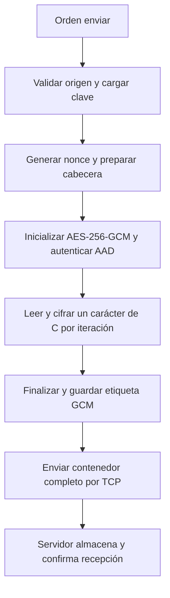

# Cifrado AES-256-GCM del cliente

Este documento describe el cifrado implementado en [crypto.c](../common/crypto.c),
su integración con el cliente y el formato que recibe el servidor. Corresponde al estado
actual del proyecto: **el cliente cifra; el servidor almacena sin descifrar ni validar la
etiqueta de autenticación**.

## 1. Algoritmo utilizado

Se utiliza **AES-256-GCM** mediante la API EVP de OpenSSL y su biblioteca `libcrypto`.
La aplicación no implementa las operaciones criptográficas de AES ni de GCM por su cuenta.

- **AES** es el algoritmo de cifrado simétrico: se necesita la misma clave secreta para
  cifrar y descifrar. El número **256** indica el tamaño de la clave en bits.
- **GCM** significa *Galois/Counter Mode*. Combina cifrado mediante contadores con una
  función de autenticación, GHASH, para generar una etiqueta o *tag*.
- El resultado protege el contenido y permite comprobar su integridad y autenticidad
  frente a alguien que no conoce la clave, siempre que se verifique la etiqueta.
- **AAD** significa *Additional Authenticated Data*: datos que se autentican junto con
  el contenido, pero que no se ocultan mediante cifrado.

Estas propiedades corresponden al modo de cifrado autenticado definido en
[NIST SP 800-38D](https://nvlpubs.nist.gov/nistpubs/Legacy/SP/nistspecialpublication800-38d.pdf).
Una etiqueta válida no identifica por sí sola a una persona: cualquiera que posea la clave
puede producir un archivo válido.

## 2. Parámetros de esta implementación

| Elemento | Valor | Uso |
| --- | --- | --- |
| Clave | 32 bytes, 256 bits | Secreto local, reutilizado entre envíos |
| Nonce o IV | 12 bytes, 96 bits | Valor aleatorio nuevo en cada cifrado |
| Etiqueta GCM | 16 bytes, 128 bits | Verifica contenido y AAD al descifrar |
| AAD | 16 bytes | Identificador `DTG1` y nonce del contenedor |
| Unidad de lectura y cifrado | 1 carácter de C, 1 byte | Una llamada de cifrado por carácter |
| Bloque de transporte TCP | 16 KiB | Transmite el contenedor ya cifrado por bloques |
| Límite del origen | 1 GiB | Límite operativo del proyecto, no del algoritmo AES |

Los tamaños del formato están definidos en [crypto.h](../common/crypto.h); el bloque de
transporte y el límite del origen se definen en [protocol.h](../common/protocol.h).
El envío TCP por bloques se realiza después del cifrado carácter por carácter.

## 3. Clave: generación, carga y conservación

La clave se genera **una sola vez para comenzar a trabajar**:

```sh
make keygen
```

El objetivo del [Makefile](../Makefile) ejecuta `openssl rand 32` y guarda los bytes binarios
en `keys/client.key`. Usa `umask 077` para crear un archivo con permisos 0600 y evita
sobrescribir uno existente. La carpeta `keys/` está excluida de Git.

No hay que ejecutar `keygen` antes de cada envío. El cliente reutiliza esa clave y genera
un nonce diferente para cada archivo. La clave no se añade al contenedor ni se transmite
al servidor. Conservarla es necesario para poder recuperar los archivos correspondientes;
generar otra clave no permite descifrar los archivos de la anterior.

`loadEncryptionKey()` comprueba que el archivo sea regular, tenga exactamente 32 bytes y
no conceda permisos al grupo ni a otros usuarios. Lee una clave binaria; no acepta una
contraseña ni una cadena hexadecimal. Si la validación falla, el envío no comienza.

| Forma de ejecución | Configuración de la clave |
| --- | --- |
| `make client` | Variable Make `KEY_FILE`, predeterminada a `keys/client.key` |
| Binario directo | Variable de entorno `TYPIST_KEY_FILE` |
| Binario sin esa variable | Ruta predeterminada `keys/client.key` |

Los buffers de clave de la aplicación se limpian mediante `OPENSSL_cleanse` tras su uso.
Esto no elimina el archivo de clave ni equivale a borrar todas las copias que puedan existir
en el sistema operativo, copias de seguridad o memoria de otros componentes.

## 4. Nonce y repetición de envíos

`encryptFile()` solicita los 12 bytes del nonce mediante `RAND_bytes()` y comprueba que
la llamada termine correctamente. El generador utiliza la fuente criptográfica de OpenSSL;
si falla, el archivo no se transmite. Véase la documentación de
[RAND_bytes](https://docs.openssl.org/3.0/man3/RAND_bytes/).

El nonce se guarda junto al contenido cifrado y no es secreto. Su función es permitir
cifrados distintos con la misma clave. Dos envíos del mismo texto normalmente producen
contenedores diferentes aunque la recuperación dé exactamente el mismo original.

No debe reutilizarse intencionalmente una combinación de clave y nonce: compromete las
garantías de GCM. La generación aleatoria reduce la posibilidad de repetición, pero el
programa no mantiene un registro de nonces para comprobar su unicidad. Esta restricción
se describe en las secciones 8 y el apéndice A de
[NIST SP 800-38D](https://nvlpubs.nist.gov/nistpubs/Legacy/SP/nistspecialpublication800-38d.pdf).

## 5. Flujo del cifrado

Al ejecutar `enviar example.txt`, el cliente procesa `input/example.txt` de esta manera:

1. **Validar el origen.** `openInput()` comprueba que sea regular, tenga una longitud
   válida y no supere 1 GiB.
2. **Cargar la clave.** `prepareEncryptedInput()` utiliza `loadEncryptionKey()` y crea
   un archivo temporal que recibirá únicamente el contenedor cifrado.
3. **Preparar la cabecera.** `encryptFile()` escribe el identificador `DTG1` y genera
   el nonce aleatorio que ocupará el resto de la cabecera.
4. **Inicializar GCM.** Crea un `EVP_CIPHER_CTX` y configura `EVP_aes_256_gcm()` con
   `EVP_EncryptInit_ex()`, la clave y el nonce de 12 bytes.
5. **Autenticar la cabecera.** Entrega sus 16 bytes como AAD mediante
   `EVP_EncryptUpdate()` con salida `NULL`; estos bytes siguen siendo visibles.
6. **Cifrar carácter por carácter.** `encryptContent()` usa `fgetc()` para obtener un
   carácter, comprueba EOF y lo convierte a `unsigned char`. Llama a `EVP_EncryptUpdate()`
   con exactamente un byte y escribe el carácter cifrado mediante `fputc()`. Mantiene el
   mismo contexto GCM entre iteraciones. El buffering interno de stdio no agrupa las
   llamadas de cifrado: cada actualización de contenido procesa un solo carácter de C.
7. **Comprobar la longitud.** Rechaza EOF prematuro y un byte adicional al terminar,
   para detectar si el archivo se redujo o creció durante el cifrado.
8. **Finalizar y obtener el tag.** Ejecuta `EVP_EncryptFinal_ex()` y obtiene los 16 bytes
   de etiqueta mediante `EVP_CTRL_GCM_GET_TAG`. GCM no añade relleno al contenido.
9. **Completar el temporal.** Escribe el tag, comprueba `fflush()`, rebobina el archivo
   cifrado y libera el contexto y la clave de trabajo. Después abre la conexión TCP.

La secuencia de inicialización, AAD, actualización y etiqueta usa la
[interfaz EVP de OpenSSL](https://docs.openssl.org/3.0/man3/EVP_EncryptInit/).



El archivo original permanece intacto. La memoria utilizada es acotada, pero el temporal
cifrado necesita espacio en disco proporcional al tamaño del origen. Si el cifrado falla,
se descarta ese temporal sin abrir la conexión. El temporal se cierra tras la transferencia.

## 6. Cifrado carácter por carácter en C

Cada iteración lee y cifra **un `char` de C, equivalente a un byte**. Se procesa el documento
completo de esta manera, incluidos saltos de línea, bytes nulos y el valor `0xFF`. La lectura
usa un `int` para distinguir EOF de cualquier valor de carácter válido antes de convertirlo.

En UTF-8 un carácter Unicode, como `á`, puede ocupar varios bytes; cada uno se cifra en
su propia iteración y se recupera sin cambios. No se realiza decodificación Unicode ni se
afirma que cada llamada corresponda a un carácter visual completo.

Se conserva **un único contexto, nonce y tag por archivo**. Cifrar un carácter en cada
actualización no significa reinicializar GCM ni generar una clave o etiqueta por carácter.
La transmisión del contenedor resultante sigue realizándose por bloques de 16 KiB.
La [API EVP permite procesar GCM de un byte en un byte](https://docs.openssl.org/3.0/man3/EVP_EncryptInit/).
Esto aumenta el número de llamadas a OpenSSL respecto al cifrado por bloques y puede ser más lento.

## 7. Formato binario DTG1

Para un origen de `N` bytes, el archivo guardado en el servidor contiene:

| Desplazamiento desde cero | Tamaño | Campo |
| --- | --- | --- |
| 0 | 4 bytes | ASCII `DTG1` |
| 4 | 12 bytes | Nonce |
| 16 | N bytes | Contenido cifrado |
| 16 + N | 16 bytes | Etiqueta GCM |

```text
DTG1 (4) | nonce (12) | contenido cifrado (N) | tag (16)
```

La cabecera de 16 bytes es el AAD. El tamaño total es `N + 32` bytes: un origen vacío
genera 32 bytes y uno de 265 bytes genera 297. El formato no almacena la clave, el nombre
original ni una contraseña; la longitud del cuerpo se obtiene restando 32 al tamaño total.

`DTG1` identifica el contenedor del archivo. **`DTP2` identifica el transporte TCP**:
la cabecera de transporte tiene 4 bytes `DTP2` y 8 bytes con el tamaño del contenedor
en orden big endian. Esa cabecera de 12 bytes no forma parte del archivo cifrado almacenado
ni del AAD. Tampoco forman parte del archivo los estados `READY` y `SUCCESS`.

## 8. Recepción y validación actuales

El servidor recibe la longitud anunciada, exige el fin del envío, cierra su temporal y
publica el resultado mediante `rename()`. Por defecto lo guarda en `output/cifrado.bin`;
cada transferencia correcta reemplaza la salida anterior.

**El servidor no dispone de la clave, no descifra el archivo y no verifica su etiqueta.**
Tampoco inspecciona el formato interno DTG1: almacena el cuerpo como bytes opacos.
`INFO: transfer confirmed` significa que recibió la confirmación de almacenamiento,
no que haya ocurrido un descifrado o una autenticación GCM.

El auxiliar [cryptoCheck.c](../tests/cryptoCheck.c), exclusivo de pruebas, sí realiza la
recuperación autenticada. Usa `EVP_DecryptUpdate()`, configura el tag esperado mediante
`EVP_CTRL_GCM_SET_TAG` y exige éxito de `EVP_DecryptFinal_ex()`. Solo publica su archivo
de salida después de esa verificación; ante un fallo de autenticación descarta el temporal.

## 9. Ejecución y comprobación

Con OpenSSL y sus encabezados de desarrollo instalados:

```sh
make
make keygen  # Solo si todavía no existe la clave
```

En dos terminales distintas, iniciar respectivamente `make server` y `make client`.
En la consola del cliente escribir `enviar example.txt` y luego `salir`.

Para verificar datos de prueba después del envío:

```sh
make bin/cryptoCheck
./bin/cryptoCheck output/cifrado.bin keys/client.key /tmp/recuperado-prueba.txt
cmp input/example.txt /tmp/recuperado-prueba.txt
sha256sum input/example.txt /tmp/recuperado-prueba.txt
```

Comparar directamente `input/example.txt` con `output/cifrado.bin` debe mostrar diferencias:
uno contiene el original y el otro el contenedor cifrado. Las comprobaciones de integridad
comparan el original con el texto **recuperado y autenticado**.

La suite `make test` cubre recuperación de archivos vacíos, pequeños, de 32 MiB y binarios;
límites de bloque; nonces diferentes; claves inválidas; alteraciones de cabecera, nonce,
cuerpo o tag; y archivos truncados. La autenticación de estos casos la prueba el auxiliar,
sin añadir descifrado al servidor.

[cryptoCharacterTest.c](../tests/cryptoCharacterTest.c) comprueba además que cada llamada
de contenido a `EVP_EncryptUpdate()` reciba exactamente un byte y que haya una llamada
por carácter leído. Usa la opción `--wrap` del enlazador GNU solo en ese ejecutable para
observar las llamadas sin reemplazar el cifrado real de OpenSSL; las actualizaciones de AAD
no se cuentan como caracteres del contenido. La entrada incluye ceros y `0xFF`, casos vacíos y
longitudes que superan el tamaño del bloque de transporte. Esta prueba falla si el cifrado agrupa
varios caracteres en una sola actualización EVP.

## 10. Límites de esta etapa

El contenido del archivo se cifra, pero la cabecera DTP2 y las respuestas siguen en claro.
No hay TLS, autenticación del servidor ni rechazo de transferencias repetidas. Se mantiene
la restricción a loopback para pruebas locales; el cifrado del archivo no convierte por
sí solo el protocolo en un canal de red completamente protegido.

El origen debe permanecer estable. Se detectan cambios de longitud, pero no se crea una
instantánea ni se detectan necesariamente cambios que conserven el mismo tamaño.

OpenMPI y el descifrado distribuido siguen pendientes. El tag actual autentica el archivo
completo: los fragmentos no son contenedores GCM independientes. La integración futura
deberá conservar esa verificación global o definir explícitamente un formato autenticado
por fragmentos, junto con la gestión de claves entre nodos.
