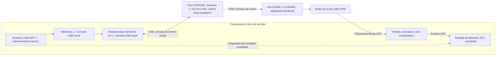

# Hardware y arquitectura prevista del dispositivo

**Actualización de diseño:** 24 de noviembre de 2026.

Este documento registra el cambio del ESP32 de la propuesta inicial a una
**Raspberry Pi Pico H original, basada en RP2040**, y el mecanismo previsto para
escribir la palabra más frecuente y su cantidad de apariciones. Describe decisiones
de diseño y trabajo pendiente; no acredita pruebas del brazo ni de su electrónica.

## 1. Hardware seleccionado

| Componente | Selección actual | Definición pendiente |
| --- | --- | --- |
| Microcontrolador | Raspberry Pi Pico H original, RP2040 | Integración USB y firmware |
| Brazo | Brazo de acrílico de MicroJPM | Montaje y alineación con el teclado |
| Servomotores | Dos SG92R y un MG90S | Asignación a articulaciones y calibración |
| Superficie de entrada | Teclado conectado a la computadora Linux del servidor | Posiciones físicas de J/K/L y recorrido del brazo |
| Alimentación y cableado | Pendientes de definir | Fuente, distribución eléctrica y conexiones definitivas |

La Pico H seleccionada pertenece a la primera generación y utiliza RP2040; no es
una Pico W ni una Pico 2. Es una placa de microcontrolador, sin Wi-Fi ni Bluetooth
integrado, y no ejecuta Linux. Las computadoras mantienen Linux y los procesos MPI.
Estas características corresponden a la [documentación oficial de la familia Pico](https://www.raspberrypi.com/documentation/microcontrollers/pico-series.html).

No se han asignado GPIO ni servos a articulaciones. Los modelos disponibles no fijan
por sí solos la geometría, los límites de movimiento ni la alimentación del conjunto.

## 2. Capas y tramos de comunicación

| Capa | Dónde se ejecuta | Responsabilidad prevista | Estado |
| --- | --- | --- | --- |
| Cliente, servidor y OpenMPI | Computadoras Linux | Cifrar, distribuir el procesamiento y obtener palabra y conteo | Implementación parcial probada localmente |
| Pantalla de selección | Misma computadora Linux que el servidor | Mostrar el carácter seleccionado e interpretar J/K/L | Pendiente |
| Biblioteca estática `.a` | Espacio de usuario de Linux | Ofrecer al servidor la API de acceso al driver propio | Base de consulta USB implementada; integración con servidor pendiente |
| Driver propio en C | Kernel de Linux, como módulo | Gestionar la interfaz del dispositivo conectado por USB y exponer las primitivas a la biblioteca | Módulo USB de consulta implementado y compilado; prueba física pendiente |
| Firmware en C con Pico SDK | Pico H, RP2040 | Recibir órdenes, generar control por GPIO y comunicar estado | Consulta USB implementada y compilada; control de servos y prueba física pendientes |
| Servos y brazo | Prototipo físico | Mover el mecanismo para pulsar J/K/L | Montaje, cableado y calibración pendientes |

La arquitectura prevista distingue dos tramos:

1. **Computadora Linux ↔ Pico H: USB**, para intercambiar órdenes y estado mediante
   el driver propio. La primera versión utiliza clase de fabricante y una petición de
   estado por EP0; los identificadores USB y las órdenes de movimiento siguen pendientes.
2. **Pico H → servos: señales de control mediante GPIO**. Los pines y parámetros de
   control se definirán al asignar y calibrar cada articulación. La alimentación de
   los servos es una decisión eléctrica pendiente, distinta del transporte de órdenes.

El teclado mantiene su conexión con la computadora Linux. La escritura prevista
depende de que el brazo presione las teclas físicamente y la pantalla interprete
esos eventos de entrada.

El firmware de la Pico, el módulo del kernel y la biblioteca `.a` son artefactos
distintos. El Pico SDK se utilizará para el firmware del RP2040; el driver se
compilará para el kernel de la computadora Linux y la biblioteca para su espacio
de usuario. La biblioteca será la única capa del proyecto que acceda al driver,
como exige el enunciado.

Un programa que solo abre `/dev/ttyACM*` o `/dev/ttyUSB*` utiliza una interfaz serial
ya provista por otro controlador; no constituye por sí mismo el módulo propio
requerido. La implementación inicial utiliza una interfaz de fabricante gestionada
por el módulo del proyecto, sin CDC serial. Se debe justificar y validar su cumplimiento
académico y verificar su carga y funcionamiento con la placa real en Linux.

## 3. Selección de caracteres con tres teclas

| Tecla pulsada por el brazo | Acción prevista |
| --- | --- |
| J | Retroceder en la selección de caracteres |
| K | Confirmar el carácter seleccionado |
| L | Avanzar en la selección de caracteres |

El objetivo sigue siendo escribir la palabra más frecuente junto con su conteo.
En este diseño las pulsaciones navegan y confirman caracteres en una pantalla de
selección que todavía no existe. Quedan pendientes el repertorio de caracteres,
la representación del conteo y sus separadores, el estado inicial de la selección,
la sincronización entre pantalla y movimientos y la detección de una pulsación aceptada.

Se conserva el requisito de señalar que terminó la escritura. El diseño histórico
mostraba un LED; la señal definitiva y el mecanismo para detectar la finalización
están pendientes, sin fijar una conexión ni un GPIO para ello.

## 4. Herramientas y preparación futura

El entorno previsto del firmware es **C con el Raspberry Pi Pico SDK**, que proporciona
las bibliotecas y el sistema de compilación para el microcontrolador. El SDK utiliza
CMake y una cadena de compilación apropiada para RP2040; no es el entorno de compilación
del módulo Linux. Véase la [introducción oficial al Pico SDK](https://www.raspberrypi.com/documentation/pico-sdk/index_doxygen.html).

| Componente | Preparación prevista |
| --- | --- |
| Firmware Pico H | Pico SDK, compilador Arm para RP2040, CMake y herramienta de construcción compatible |
| Carga del firmware | Procedimiento y prueba física pendientes; BOOTSEL/UF2 depende de las herramientas del SDK |
| Driver Linux | Encabezados del kernel y Kbuild; `make driver` compila el módulo sin cargarlo |
| Biblioteca `.a` | Compilador C y archivador; `make hardware-library` genera la API inicial de consulta |
| Sistema distribuido existente | Conservar las dependencias y comandos actuales de C, OpenSSL y OpenMPI |

La primera versión y sus verificaciones se describen en [usb-bringup.md](usb-bringup.md).
`make firmware` requiere la ruta del SDK y parámetros USB explícitos; todavía no se
ha cargado en la placa. El [repositorio oficial del Pico SDK](https://github.com/raspberrypi/pico-sdk)
describe la preparación y la carga UF2. La base actual usa el bucle cooperativo de
TinyUSB sin incorporar FreeRTOS; no decide el entorno del futuro control de servos.

## 5. Decisiones y validaciones pendientes

- Elegir VID/PID y presupuesto de corriente del dispositivo USB; validar los descriptores
  de fabricante y ampliar la consulta inicial al protocolo de órdenes, estados y errores.
- Ampliar la API de la biblioteca y la interfaz del driver para el control físico y su
  integración con el servidor; justificar que el módulo propio cumple el requisito académico.
- Diseñar e implementar la pantalla de selección y la integración del resultado del
  servidor con las acciones J/K/L, conservando palabra y cantidad como salida final.
- Asignar los dos SG92R y el MG90S a las articulaciones; definir GPIO, posiciones,
  límites, tiempos y parámetros de control mediante calibración del montaje real.
- Definir la alimentación de los servos y el cableado definitivo, y documentar sus diagramas.
- Determinar la señal de finalización y el criterio para confirmar cada pulsación.
- Completar procedimientos de carga y pruebas físicas; la evidencia de compilación de
  esta primera versión y las herramientas usadas están en [usb-bringup.md](usb-bringup.md).
- Validar la integración física y el despliegue en tres equipos Linux; conservar las
  tareas pendientes de seguridad y rendimiento descritas en [las pruebas MPI](mpi-testing.md).

El enunciado recomienda GPIO y exige un driver propio en el kernel. La elección de
USB en la computadora y GPIO en la Pico distingue los dos tramos, pero queda por
justificar y validar el diseño concreto del módulo USB frente a ese requisito.
Esta documentación no acredita aprobación del profesor ni pruebas del hardware nuevo.

## 6. Referencias históricas y alcance

La propuesta inicial del 5 de noviembre de 2026 utilizaba un ESP32, contemplaba un
teclado o iPad y representaba un LED de finalización. Las imágenes originales se
conservan como evidencia histórica en `.codex/SO_PropuestaP2.md`; sus referencias
al ESP32 no describen el hardware actual. El texto actualizado y los diagramas Mermaid
documentan Pico H, USB, el brazo MicroJPM y las tres teclas del teclado de la computadora.

El cambio de hardware no elimina los requisitos de tres nodos de procesamiento,
cifrado de la información de red, driver propio en C, biblioteca estática, documentación
y señal de finalización. La validación local de MPI no demuestra la integración con
el brazo, la pantalla o la Pico H. Antes de implementar o modificar código se deben
releer los estándares de programación de `.codex/estandares_de_programacion.md`.
