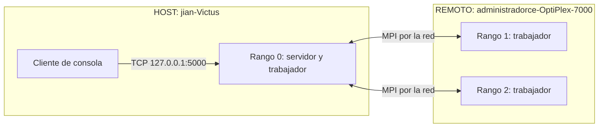

# Guía completa: conectar dos computadoras y ejecutar el sistema distribuido

Esta topología intermedia coloca el rango 0 (servidor y trabajador) en `jian-Victus`
y los rangos 1 y 2 en `administradorce-OptiPlex-7000`. El cliente se ejecuta en
`jian-Victus`. La topología con tres computadoras físicas ya se probó por separado
y se documenta en [mpi-three-hosts.md](mpi-three-hosts.md).

La guía reproduce la configuración que funcionó en la prueba del proyecto. Cada
bloque indica dónde ejecutarlo: **HOST** es la computadora coordinadora y
**REMOTO** es la otra computadora. Usar una terminal de Ubuntu, como la terminal
integrada de VS Code. Las líneas de comandos no incluyen el indicador `usuario@equipo$`.

Si vas a repetir la prueba en los dos equipos que ya preparamos, comienza en
[ejecución habitual](#11-ejecución-habitual-sin-reinstalar).

## Índice

1. [Equipos, red y rutas](#1-equipos-red-y-rutas).
2. [Dependencias y repositorio](#2-dependencias-y-repositorio).
3. [SSH desde el host al remoto](#3-ssh-desde-el-host-al-remoto).
4. [La misma clave AES en ambos equipos](#4-la-misma-clave-aes-en-ambos-equipos).
5. [Descargar e instalar OpenMPI 4.1.6](#5-descargar-e-instalar-openmpi-416).
6. [Compilar el proyecto](#6-compilar-el-proyecto).
7. [Diagnóstico de comunicación MPI](#7-diagnóstico-de-comunicación-mpi).
8. [Cliente y servidor reales](#8-cliente-y-servidor-reales).
9. [Comprobar conexión y trabajadores](#9-comprobar-conexión-y-trabajadores).
10. [Detener el sistema](#10-detener-el-sistema).
11. [Ejecución habitual sin reinstalar](#11-ejecución-habitual-sin-reinstalar).
12. [Problemas frecuentes](#12-problemas-frecuentes).
13. [Incorporar una tercera computadora](#13-incorporar-una-tercera-computadora).
14. [Validación realizada](#14-validación-realizada).

## 1. Equipos, red y rutas

| Dato | Coordinador | Equipo remoto |
| --- | --- | --- |
| Usuario | `jian` | `user` |
| IPv4 de esta prueba | `172.18.37.0` | `172.18.238.179` |
| Repositorio | `/home/jian/Desktop/distributed-typist` | `/home/user/distributed-typist` |

El remoto de esta prueba utiliza Ubuntu 22.04.5 LTS. Ambos equipos ejecutan Linux
de forma nativa. No necesitan tener el mismo nombre de usuario ni la misma ruta
del repositorio: los comandos de lanzamiento ya distinguen esas rutas.



En **cada computadora**, ejecutar:

```sh
hostname
hostname -I
whoami
pwd
```

Las direcciones pueden cambiar. Comprobarlas con `hostname -I` antes de reutilizar
los comandos. Ambos equipos necesitan el mismo código, compilador C, `make`,
cabeceras de OpenSSL y una copia local de la misma clave `keys/client.key` de
32 bytes con permisos `0600`. No generar una clave distinta en el remoto ni
agregarla a Git. Cada equipo conserva su repositorio; no se comparte un directorio
para transportar documentos o resultados.

Elegir la dirección de la interfaz que permite comunicar ambos equipos; no usar
`127.0.0.1` como dirección del remoto. Si aparecen varias direcciones, identificar
la de la red utilizada para la prueba. Las IP de la tabla son las observadas en
esta sesión, no direcciones que debas asignar manualmente.

Si cambian IP, usuario o ruta, reemplazar sus apariciones en los comandos SSH,
`--host`, `--wdir`, `--launch-agent`, ejecutables y clave remota de esta guía.
La dirección TCP del cliente permanece `127.0.0.1`: este se ejecuta en el host.

## 2. Dependencias y repositorio

### 2.1. Instalar dependencias — AMBOS equipos

```sh
sudo apt update
sudo apt install build-essential libssl-dev openssl git curl ca-certificates openssh-client
```

### 2.2. Habilitar SSH — REMOTO

```sh
sudo apt install openssh-server
sudo systemctl enable --now ssh
systemctl is-active ssh
```

El último comando debe mostrar `active`. El remoto necesita poder recibir conexiones
SSH del host. La red también debe permitir el tráfico de MPI entre ambos equipos;
tener solamente el puerto 5000 accesible no resuelve la comunicación de los trabajadores.

### 2.3. Clonar o entrar al repositorio

Si ya está clonado, **no volver a clonarlo**; entrar en su carpeta con `cd`.
Para una instalación nueva, usar los siguientes bloques.

**HOST**, solo si todavía no existe el repositorio:

```sh
mkdir -p /home/jian/Desktop
cd /home/jian/Desktop
git clone https://github.com/Fabbbri/distributed-typist.git
cd distributed-typist
```

**REMOTO**, solo si todavía no existe el repositorio:

```sh
cd /home/user
git clone https://github.com/Fabbbri/distributed-typist.git
cd distributed-typist
```

Para entrar de nuevo desde cualquier terminal:

| Equipo | Comando |
| --- | --- |
| HOST | `cd /home/jian/Desktop/distributed-typist` |
| REMOTO | `cd /home/user/distributed-typist` |

No es necesario entrar al directorio de OpenMPI para usar Git o ejecutar el proyecto.
Los comandos siguientes parten de la raíz del repositorio, salvo indicación expresa.

En **ambos equipos**, comparar la salida de:

```sh
git status --short
git rev-parse HEAD
```

Usar la misma revisión del código y revisar también los cambios sin commit. Si los
cambios del host aún no están subidos a Git, el clon del remoto no los recibirá.
Cuando estén publicados y la copia local esté limpia, actualizarla con
`git pull --ff-only`. Conservar cualquier cambio local antes de actualizar.

## 3. SSH desde el host al remoto

### 3.1. Probar el acceso — HOST

```sh
ssh user@172.18.238.179
```

La primera conexión puede pedir confirmar la huella del equipo. Para comprobarla,
ejecutar `ssh-keygen -lf /etc/ssh/ssh_host_ed25519_key.pub` directamente en el remoto
y comparar la huella si SSH presenta esa clave. Confirmar la conexión cuando
corresponda al equipo esperado.

La contraseña solicitada es la del usuario Linux `user` en el remoto. Al entrar,
el indicador de la terminal cambia a algo como:

```text
user@administradorce-OptiPlex-7000:~$
```

Los comandos escritos en esa sesión se ejecutan en el remoto. Para volver a la
terminal del host, ejecutar:

```sh
exit
```

### 3.2. Preparar acceso sin interacción — HOST

Comprobar si ya existe una clave pública SSH:

```sh
ls -l "$HOME/.ssh/id_ed25519.pub"
```

Si no existe y no tienes otra clave SSH que quieras reutilizar, crearla:

```sh
ssh-keygen -t ed25519
```

Aceptar la ruta predeterminada. Conservar las claves existentes; si utilizas otra
ruta, ajustar los comandos siguientes. Si proteges la clave con una frase de paso,
cargarla en el agente SSH de la sesión:

```sh
ssh-add "$HOME/.ssh/id_ed25519"
```

Si `ssh-add` indica que no hay un agente disponible, iniciarlo primero con
`eval "$(ssh-agent -s)"` y repetir `ssh-add`. La frase de paso se escribe de forma
interactiva; los lanzamientos MPI posteriores deben funcionar sin pedirla.

Copiar **la clave pública** al remoto:

```sh
ssh-copy-id -i "$HOME/.ssh/id_ed25519.pub" user@172.18.238.179
```

Este paso puede pedir una última vez la contraseña Linux del remoto. No copiar
el archivo privado `id_ed25519` al otro equipo.

Desde el coordinador, verificar el acceso sin contraseña interactiva:

```sh
ssh -o BatchMode=yes user@172.18.238.179 hostname
```

Debe devolver `administradorce-OptiPlex-7000` sin preguntar contraseña. Esta es la
comprobación de SSH; aún no demuestra que el intercambio de datos MPI funcione.

## 4. La misma clave AES en ambos equipos

La clave SSH anterior autentica el acceso al remoto. **`keys/client.key` es otra
clave distinta**, utilizada por el proyecto para AES-256-GCM. El cliente y los
tres procesos MPI deben usar los mismos 32 bytes.

### 4.1. Comprobar o generar la clave — HOST

```sh
cd /home/jian/Desktop/distributed-typist
stat -c 'size=%s mode=%a' keys/client.key
```

Si todavía no existe, generarla **solo en el host**:

```sh
make keygen
```

Conservarla si ya existe. Asegurar los permisos y comprobar el tamaño sin mostrar
su contenido:

```sh
chmod 600 keys/client.key
stat -c 'size=%s mode=%a' keys/client.key
```

Se espera `size=32 mode=600`.

### 4.2. Copiarla al remoto — HOST, solo si falta allí

```sh
ssh -o BatchMode=yes user@172.18.238.179 \
    'umask 077; mkdir -p /home/user/distributed-typist/keys && set -C && cat > /home/user/distributed-typist/keys/client.key' \
    < keys/client.key
```

El comando transmite la clave por SSH, sin imprimirla. `set -C` impide sobrescribir
una clave remota existente. Si informa que ya existe, pasar a la comparación;
no borrarla automáticamente ni ejecutar `make keygen` en el remoto.

### 4.3. Verificar que coinciden — HOST

```sh
ssh -o BatchMode=yes user@172.18.238.179 \
    'cmp -s /home/user/distributed-typist/keys/client.key - && stat -c "SHARED_KEY_OK: size=%s mode=%a" /home/user/distributed-typist/keys/client.key' \
    < keys/client.key
```

Debe mostrar `SHARED_KEY_OK: size=32 mode=600`. Si no lo muestra, comprobar si
falta la clave remota o si su contenido es diferente antes de continuar. Si
coinciden los bytes pero el permiso difiere, ejecutar en el remoto:

```sh
chmod 600 /home/user/distributed-typist/keys/client.key
```

Las claves y los directorios `build/` y `bin/` no viajan al clonar el repositorio;
por eso se preparan en cada equipo. No agregar claves privadas a Git.

## 5. Descargar e instalar OpenMPI 4.1.6

### 5.1. Por qué usamos una instalación dentro de build/

Que ambos `mpirun --version` indiquen `4.1.6` no asegura que las instalaciones
utilicen las mismas bibliotecas internas. En esta preparación, el paquete de Ubuntu
del coordinador usaba PMIx externo (`ext3x`), mientras que `/opt/openmpi-4.1.6`
del remoto usaba `pmix3x`. La ejecución combinada falló dentro de PMIx. Otro intento
con bibliotecas auxiliares distintas falló al arrancar los demonios MPI. La
configuración que finalmente pasó se compiló con las mismas opciones en ambos equipos.

Para estas pruebas se preparan instalaciones separadas con las mismas opciones en
`build/openmpi-4.1.6`. No reemplazan `/usr/bin/mpirun` ni la instalación de `/opt`.
La versión 4.1.6 es la utilizada en esta prueba; no se presenta como la versión
más reciente. Si el `mpirun` del sistema dice 3.3.2, se puede conservar: aquí se
selecciona explícitamente la instalación del proyecto.

### 5.2. Descargar y compilar — AMBOS equipos

Desde la raíz de **cada copia del repositorio**, ejecutar este bloque completo
si todavía no está instalada esta configuración. Los paréntesis mantienen el
cambio de directorio dentro del bloque y `set -e` detiene los pasos ante un error:

```sh
(
set -e
typistRepoDir="$PWD"
mkdir -p build/mpi-source
cd build/mpi-source
curl -fL https://download.open-mpi.org/release/open-mpi/v4.1/openmpi-4.1.6.tar.gz \
    -o openmpi-4.1.6.tar.gz
printf '%s  %s\n' \
    44da277b8cdc234e71c62473305a09d63f4dcca292ca40335aab7c4bf0e6a566 \
    openmpi-4.1.6.tar.gz | sha256sum -c -
tar -xzf openmpi-4.1.6.tar.gz
cd openmpi-4.1.6
./configure --prefix="$typistRepoDir/build/openmpi-4.1.6" \
    --libdir="$typistRepoDir/build/openmpi-4.1.6/lib" \
    --disable-mpi-fortran --disable-oshmem \
    --with-pmix=internal --with-hwloc=internal --with-libevent=internal \
    --without-verbs --without-ucx
make -j4
make install
)
```

El código fuente y la suma de verificación proceden de la
[distribución oficial de OpenMPI 4.1](https://www.open-mpi.org/software/ompi/v4.1/).
Estos pasos compilan una herramienta externa y pueden tardar varios minutos.
No requieren `sudo make install`, porque el prefijo pertenece al usuario.

`--with-pmix=internal`, `--with-hwloc=internal` y `--with-libevent=internal`
seleccionan las copias incluidas de esas bibliotecas. Las otras opciones conservan
la configuración probada para este proyecto en C y su comunicación por TCP.

No mover el repositorio después de instalar: el prefijo contiene su ruta absoluta.
Si cambia la ruta, volver a configurar e instalar con el nuevo prefijo y recompilar
los ejecutables del proyecto.

### 5.3. Verificar la instalación — AMBOS equipos

Desde la raíz del repositorio:

```sh
build/openmpi-4.1.6/bin/mpirun --version
build/openmpi-4.1.6/bin/ompi_info --param pmix all
build/openmpi-4.1.6/bin/ompi_info --config
```

La primera salida debe indicar `Open MPI 4.1.6`; los componentes PMIx deben incluir
`pmix3x`. Comparar también las opciones de configuración entre ambos equipos.

Desde el **HOST**, verificar el ejecutable remoto en una sesión no interactiva:

```sh
ssh -o BatchMode=yes user@172.18.238.179 \
    '/home/user/distributed-typist/build/openmpi-4.1.6/bin/mpirun --version'
```

Estos comandos no necesitan modificar `PATH` ni `LD_LIBRARY_PATH`. Ejecutar
`mpirun --version` sin ruta puede seguir mostrando la versión del sistema o la
de `/opt`; no es el ejecutable que se usa en los lanzamientos de esta guía.

## 6. Compilar el proyecto

En **ambos equipos**, desde la raíz de su repositorio:

```sh
(
set -e
mkdir -p build/two-host
build/openmpi-4.1.6/bin/mpicc \
    -D_POSIX_C_SOURCE=200809L -D_FILE_OFFSET_BITS=64 -Icommon \
    -std=c11 -O2 -Wall -Wextra -Wpedantic \
    tests/mpiSmoke.c -o build/two-host/mpiSmoke
build/openmpi-4.1.6/bin/mpicc \
    -D_POSIX_C_SOURCE=200809L -D_FILE_OFFSET_BITS=64 -Icommon \
    -std=c11 -O2 -Wall -Wextra -Wpedantic \
    server/cluster.c server/server.c server/wordCount.c \
    common/protocol.c common/crypto.c -lcrypto -o build/two-host/clusterServer
)
```

Los ejecutables quedan separados de `bin/`, para conservar las pruebas locales
que usan el OpenMPI del sistema. Si cambia el código, repetir esta compilación
en ambos equipos.

En el **HOST**, compilar además el cliente:

```sh
make bin/client
```

Para comprobar que un ejecutable usa la biblioteca MPI recién instalada, ejecutar
en cada equipo:

```sh
ldd build/two-host/clusterServer
```

`libmpi.so.40` debe resolver dentro de la instalación `build/openmpi-4.1.6/lib`
de ese equipo, sin bibliotecas `not found`.

## 7. Diagnóstico de comunicación MPI

Ejecutar **solo en el coordinador**, desde `/home/jian/Desktop/distributed-typist`:

```sh
cd /home/jian/Desktop/distributed-typist
build/openmpi-4.1.6/bin/mpirun \
    --noprefix --oversubscribe --bind-to none --tag-output \
    --launch-agent /home/user/distributed-typist/build/openmpi-4.1.6/bin/orted \
    --mca plm_rsh_agent 'ssh -l user -o BatchMode=yes' \
    --mca pml ob1 --mca btl self,vader,tcp \
    -np 1 --host 172.18.37.0 --wdir "$PWD" \
    "$PWD/build/two-host/mpiSmoke" \
    : -np 2 --host 172.18.238.179 --wdir /home/user/distributed-typist \
    /home/user/distributed-typist/build/two-host/mpiSmoke
```

Se espera el rango 0 en `jian-Victus`, los rangos 1 y 2 en el remoto, `total=6`
en los tres y el mensaje `PASS`. Este diagnóstico todavía no ejecuta el cliente
ni el servidor del proyecto.

Ejemplo de salida, omitiendo PID y prefijos de MPI que pueden variar:

```text
INFO: rank=0 host=jian-Victus contribution=1 total=6
INFO: rank=1 host=administradorce-OptiPlex-7000 contribution=2 total=6
INFO: rank=2 host=administradorce-OptiPlex-7000 contribution=3 total=6
PASS: all three MPI processes participated (1 + 2 + 3 = 6)
```

El orden puede cambiar. No pasar a la prueba integral si este diagnóstico falla.

Las rutas son distintas en los dos equipos: `--noprefix` evita propagar el prefijo
local al remoto y `--launch-agent` selecciona su `orted`. Los dos contextos,
separados por `:`, pertenecen a una sola ejecución MPI. Las opciones `pml` y `btl`
seleccionan comunicación TCP para esta red. SSH permite arrancar procesos, pero no
cifra por sí mismo su tráfico MPI. Las opciones se describen en el
[manual de mpirun 4.1](https://www.open-mpi.org/doc/v4.1/man1/mpirun.1.php).

## 8. Cliente y servidor reales

### 8.1. Terminal 1 — HOST: iniciar el servidor distribuido

```sh
cd /home/jian/Desktop/distributed-typist
mkdir -p output
build/openmpi-4.1.6/bin/mpirun \
    --noprefix --oversubscribe --bind-to none --tag-output \
    --launch-agent /home/user/distributed-typist/build/openmpi-4.1.6/bin/orted \
    --mca plm_rsh_agent 'ssh -l user -o BatchMode=yes' \
    --mca pml ob1 --mca btl self,vader,tcp \
    -np 1 --host 172.18.37.0 --wdir "$PWD" \
    "$PWD/build/two-host/clusterServer" 127.0.0.1 5000 \
    "$PWD/output/cifrado.bin" "$PWD/output/descifrado.txt" \
    "$PWD/output/conteos.txt" "$PWD/keys/client.key" \
    : -np 2 --host 172.18.238.179 --wdir /home/user/distributed-typist \
    /home/user/distributed-typist/build/two-host/clusterServer 127.0.0.1 5000 \
    output/cifrado.bin output/descifrado.txt output/conteos.txt \
    /home/user/distributed-typist/keys/client.key
```

Esperar el mensaje:

```text
INFO: listening on 127.0.0.1:5000 (local TCP + three MPI workers)
```

Las salidas persistentes solo se escriben en el coordinador. No iniciar otro
servidor en el puerto 5000. **En el REMOTO no se ejecuta otro `mpirun` ni se inicia
manualmente `clusterServer`**: el lanzamiento del host crea sus dos trabajadores.

Este comando sustituye a `make cluster-server` para esta prueba entre equipos;
`make cluster-server` sin opciones adicionales inicia los tres rangos localmente.

### 8.2. Terminal 2 — HOST: preparar el archivo y abrir el cliente

```sh
cd /home/jian/Desktop/distributed-typist
mkdir -p input
if [ ! -e input/nodos.txt ]; then
    printf 'aaa aaa comun comun\nbbb bbb comun comun\nccc ccc comun comun\n' \
        > input/nodos.txt
fi
cat input/nodos.txt
make client
```

Para obtener el resultado de ejemplo, el archivo debe contener estas tres líneas:

```text
aaa aaa comun comun
bbb bbb comun comun
ccc ccc comun comun
```

El bloque conserva `nodos.txt` si ya existe. Si contiene otro texto, los conteos
esperados cambiarán; puedes crear otro archivo con el ejemplo y enviar su nombre.

En el cliente:

```text
enviar nodos.txt
salir
```

`enviar` se escribe en la consola `client>`, no en Bash. El cliente busca el nombre
relativo dentro de `input/`. `salir` cierra el cliente, pero deja el servidor activo
para aceptar nuevos envíos.

### 8.3. Comprobar el resultado — HOST

El resultado esperado es `word=comun count=6 totalWords=12`. Comprobar las tres
líneas `worker rank=...`: el rango 0 debe mostrar el hostname del coordinador
y los otros dos el remoto. Cada rango procesa 20 bytes y cuatro palabras.
Después del envío:

```sh
cmp input/nodos.txt output/descifrado.txt
cat output/conteos.txt
```

`cmp` termina sin mostrar nada y con estado 0 si los archivos son idénticos.
El diccionario, cuyo orden de líneas puede variar, debe contener:

```text
DTC1
2	aaa
2	bbb
2	ccc
6	comun
```

Entre la cantidad y la palabra hay una tabulación. El archivo original cifrado
queda en `output/cifrado.bin`. Cada envío correcto reemplaza estas salidas.

Esta prueba no usa el driver, la biblioteca ni la Pico H. Las limitaciones de
seguridad del protocolo, el tiempo de espera del cliente y los pendientes del
proyecto se mantienen en [mpi-testing.md](mpi-testing.md).

## 9. Comprobar conexión y trabajadores

### 9.1. Desde otra terminal del HOST

Para comprobar que el remoto responde por SSH:

```sh
ssh -o BatchMode=yes user@172.18.238.179 hostname
```

Para ver los procesos del servidor mientras está ejecutándose el lanzamiento MPI:

```sh
ssh -o BatchMode=yes user@172.18.238.179 \
    'pgrep -a -x clusterServer'
```

Se esperan dos procesos en el remoto. Si no hay coincidencias, `pgrep` no muestra
salida y devuelve estado 1. Esto es normal si todavía no iniciaste el servidor o
si ya lo detuviste.

### 9.2. Desde la terminal del REMOTO

```sh
pgrep -a -x clusterServer
top -u user
```

`top` permite observar los recursos y se cierra con `q`. Los trabajadores pueden
estar esperando sin consumir mucha CPU; un archivo pequeño se procesa demasiado
rápido para apreciarlo en cada actualización del monitor.

SSH disponible demuestra acceso al equipo. Ver procesos demuestra que están
ejecutándose. **Las líneas `worker rank=1` y `worker rank=2`, con el hostname remoto
y los conteos tras un envío, confirman que participaron en esa tarea.**

El remoto debe permanecer encendido, sin suspenderse, conectado a la red y con SSH
activo. No necesita mantener abierta una terminal SSH ni VS Code.

## 10. Detener el sistema

En otra terminal del **HOST**, enviar `SIGTERM` al PID que apareció como
`cluster coordinator pid=...` al iniciar esta ejecución:

```sh
kill -TERM PID
```

Sustituir `PID` por ese número; cambia en cada lanzamiento. El coordinador deja de
escuchar, envía la parada a los trabajadores y los procesos finalizan. Comprobarlo
con el comando SSH de `pgrep` de la sección anterior: ya no debe mostrar trabajadores
de esa ejecución.

También se puede interrumpir el lanzador con `Ctrl+C` en la terminal 1; OpenMPI
puede mostrar mensajes de interrupción. La parada con `SIGTERM` al coordinador es
la utilizada para comprobar el cierre coordinado del programa.

## 11. Ejecución habitual sin reinstalar

Después de la preparación inicial, cada nueva sesión requiere estos pasos:

| Paso | Equipo | Acción |
| --- | --- | --- |
| 1 | REMOTO | Encender, conectar a la red y comprobar `systemctl is-active ssh`. |
| 2 | AMBOS | Consultar `hostname -I` y ajustar las IP de los comandos si cambiaron. |
| 3 | HOST | Comprobar `ssh -o BatchMode=yes user@172.18.238.179 hostname`. |
| 4 | HOST, terminal 1 | Ejecutar el comando del servidor de la sección 8.1. |
| 5 | HOST, terminal 2 | Entrar al repositorio, ejecutar `make client` y `enviar nodos.txt`. |
| 6 | HOST | Revisar hostnames de los tres rangos, conteos y archivos de salida. |
| 7 | HOST | Detener con `SIGTERM` al coordinador cuando termine la prueba. |

No hay que descargar ni compilar OpenMPI de nuevo en cada sesión. Si modificas el
código, sincronizar las copias y recompilar los ejecutables de la sección 6 en
ambos equipos. Si borras `build/`, tendrás que reconstruir esta instalación MPI y
los ejecutables. Si cambia la clave AES, volver a provisionar la misma clave en
todos los participantes antes de arrancar.

## 12. Problemas frecuentes

| Síntoma | Qué revisar |
| --- | --- |
| `No such file or directory` al enviar `nodos.txt` | En la terminal Bash del host, desde el repositorio, ejecutar `ls -l input/nodos.txt`. Crear el ejemplo de la sección 8.2 si falta. Después repetir `enviar nodos.txt` en el cliente que sigue abierto. |
| SSH pide contraseña o falla con `BatchMode=yes` | Confirmar usuario e IP, repetir `ssh-copy-id` y, si hay frase de paso, cargar la clave con `ssh-add`. MPI necesita acceso sin preguntas interactivas. |
| SSH muestra `Connection refused` | En el remoto comprobar `systemctl is-active ssh` y arrancar el servicio si corresponde. |
| SSH termina por tiempo de espera o no hay ruta | Revisar IP actuales, conexión de red, suspensión y reglas de acceso. Las redes con aislamiento entre clientes pueden impedir la prueba. |
| `mpirun --version` muestra otra versión | Usar `build/openmpi-4.1.6/bin/mpirun --version` desde la raíz del proyecto. No confundir `/usr/bin`, `/opt` y `build/`. |
| MPI informa fallos PMIx, `Data unpack` o no arranca `orted` | Revisar las instalaciones de la sección 5, las mismas opciones en ambos equipos, las rutas del lanzador y `--launch-agent`. No mezclar los ejecutables de `bin/` con el MPI separado de `build/`. |
| No se encuentra un ejecutable o biblioteca en el remoto | Revisar `--wdir`, las rutas absolutas y `ldd build/two-host/clusterServer` allí. Compilar localmente en cada equipo. |
| Error sobre clave privada de 32 bytes o autenticación inicial | Verificar tamaño, permisos y coincidencia con la sección 4; el remoto no debe generar una clave diferente. |
| `Address already in use` en el host | Comprobar con `ss -ltnp 'sport = :5000'` si ya hay un servidor. Usar el existente o detener la ejecución correspondiente antes de iniciar otra. |
| El cliente no consigue conectar | Esperar el mensaje `INFO: listening` del servidor y confirmar que cliente y rango 0 están en el host y usan el mismo puerto. |
| No aparecen procesos en `pgrep` | Verificar que el servidor MPI sigue activo. Después de detenerlo, que no aparezcan es lo esperado. |
| Los tres rangos muestran `jian-Victus` | Se lanzó una prueba local. Usar el comando completo de la sección 8.1 con sus dos contextos separados por `:`. |
| SSH funciona pero `mpiSmoke` se bloquea | Revisar la comunicación de red entre los procesos. SSH permite el arranque; MPI utiliza conexiones adicionales. No desactivar el firewall como solución general. |

El cliente tiene una espera de diez segundos por operación de recepción. Un envío
muy grande puede perder la confirmación final aunque el procesamiento termine
después; comenzar con el ejemplo pequeño. No volver a enviar automáticamente sin
revisar primero los registros del servidor.

## 13. Incorporar una tercera computadora

Esta guía deja un rango en el host y dos en el mismo remoto. Para pasar a tres
equipos físicos, preparar también el tercero con código, clave AES y OpenMPI
compatibles, y comprobar SSH y conectividad entre los participantes que utilice
el lanzamiento. La distribución debe cambiar a un rango por computadora, con
rango 0 en el host. No iniciar tres lanzadores MPI independientes ni añadir un
cuarto rango al programa actual, que requiere exactamente tres.

El ejemplo general está en [mpi-testing.md](mpi-testing.md#4-ejecución-en-tres-computadoras-linux).
Sus comandos suponen las mismas rutas en los tres equipos; si difieren, hay que
adaptar los contextos y el arranque remoto. La configuración que pasó la prueba con
tres equipos y rutas distintas se describe en [mpi-three-hosts.md](mpi-three-hosts.md).

## 14. Validación realizada

El 25 de noviembre de 2026 se verificó esta distribución con instalaciones
compiladas con las mismas opciones en ambos equipos:

- Diagnóstico `mpiSmoke`: tres rangos, hostnames esperados y suma 6.
- Cliente TCP real y cliente interactivo: confirmación del envío y resultado global
  `comun`, 6 apariciones entre 12 palabras; cada rango procesó su propio fragmento.
- Identidad del texto recuperado, autenticación del archivo cifrado almacenado y
  comparación de todos los conteos con los esperados.
- Mensajes MPI de varios bloques con 3001 palabras únicas, puntuación, UTF-8 y
  archivo vacío.
- Parada coordinada con `SIGTERM` y finalización correcta del lanzador.

Se usaron salidas temporales, sin reemplazar los resultados habituales de `output/`.
Esta prueba de dos equipos no mide aceleración. La validación adicional con tres
equipos físicos se documenta en [mpi-three-hosts.md](mpi-three-hosts.md).

## Referencias

- [Fuentes y sumas de verificación de OpenMPI 4.1](https://www.open-mpi.org/software/ompi/v4.1/).
- [Manual oficial de mpirun de la serie 4.1](https://www.open-mpi.org/doc/v4.1/man1/mpirun.1.php).
- [Algoritmo, límites y pendientes del proyecto](mpi-testing.md).
